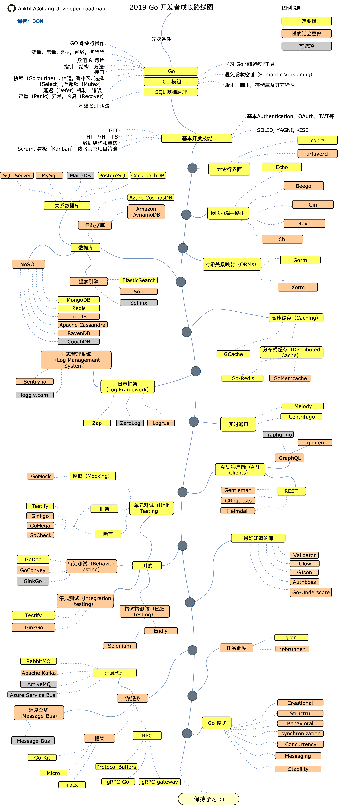

# README

## 一 笔记说明

这份笔记是自学`Golang`时的资料总结，结合了很多书籍、博客以及开源作品的内容，同时也收到了很多反馈和建议，笔记仍然会在学习旅程中不断更新，绝对不鸽。  
基于 Go 的算法笔记一样计划之列，不过算法过于庞大，被独立放置在了[overnote](https://github.com/overnote/over-algorithm)系列中自成一系。

## 二 Go 学习路径图

## 三 Go 相关书籍

基础：

- [《Go语言权威指南》](https://book.douban.com/subject/37008202/)
- [《Go 程序设计语言》](https://book.douban.com/subject/27044219/)：Go 语言圣经，[中译资料](https://github.com/gopl-zh/gopl-zh.github.com)
- [《Go 语言编程之旅》](https://book.douban.com/subject/35130972/)

深入：

- [《Go 语言精进之路》](https://book.douban.com/subject/35720728/)
- [《Go 语言高级编程》](https://book.douban.com/subject/34442131/)
- [《100个Go语言典型错误》](https://book.douban.com/subject/36715297/)
- [《Go 语言学习笔记》](https://book.douban.com/subject/26832468/)
- [《深入Go语言：原理、关键技术与实战》](https://book.douban.com/subject/36351316/)
- [《深度探索Go语言》](https://book.douban.com/subject/36104087/)
- [《Go语言中的高效并发技术》](https://book.douban.com/subject/36924830/)
- [《深入理解Go语言》](https://book.douban.com/subject/36403287/)
- [《Go 专家编程》第 2 版](https://book.douban.com/subject/36356905/)
- [《Go语言设计与实现》](https://book.douban.com/subject/35635836/)
